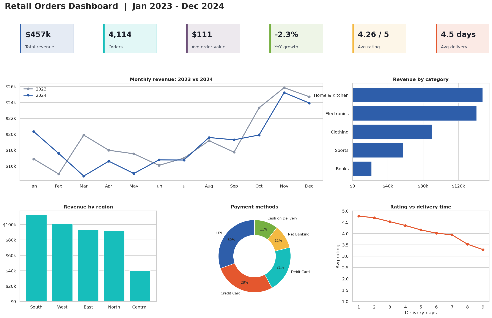
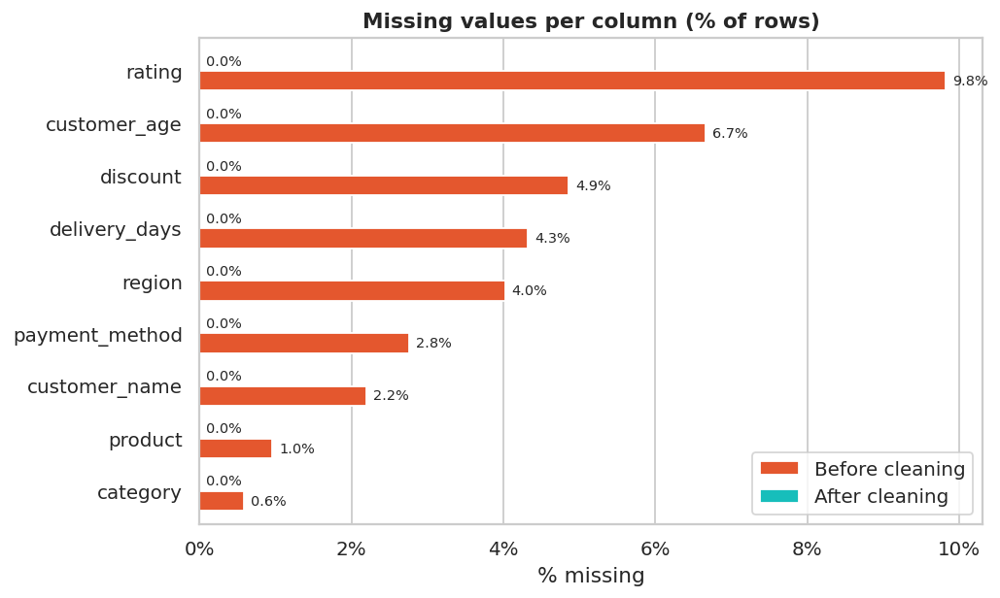
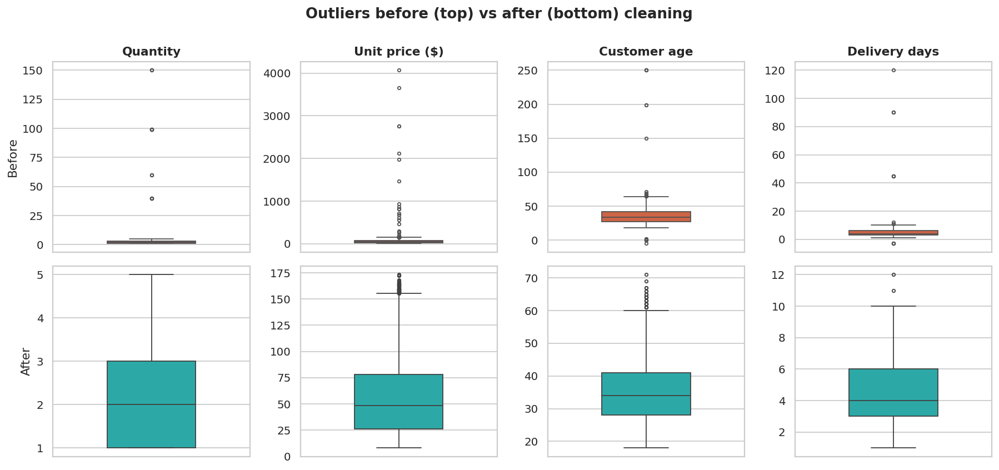
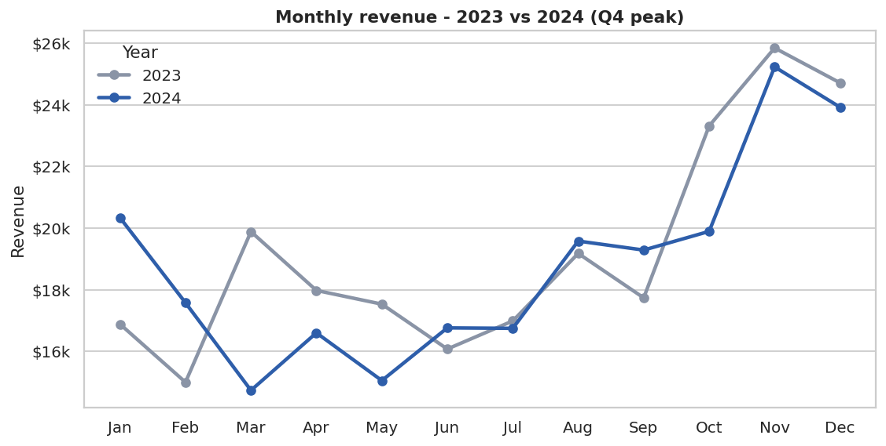
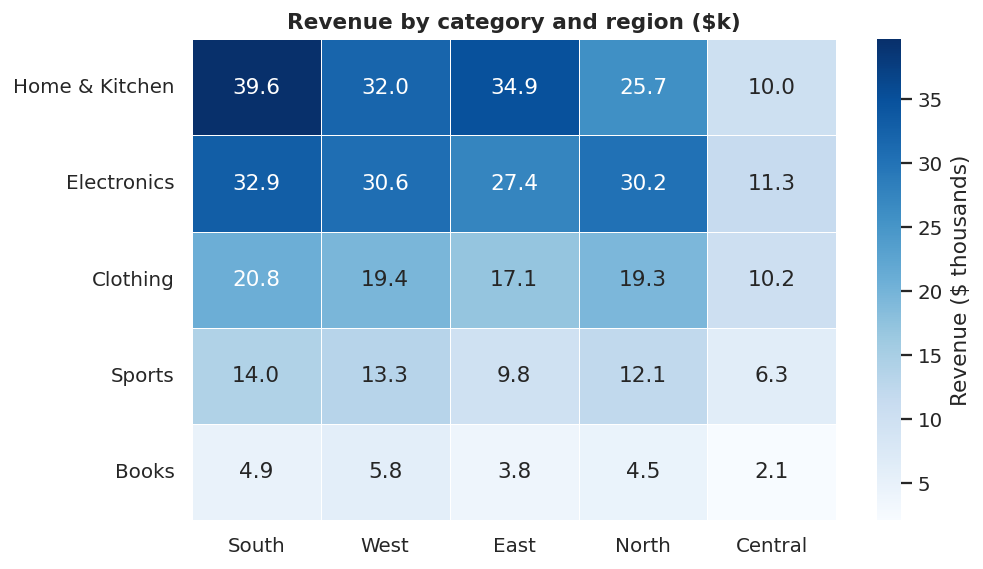

# Data Cleaning & Visualization Project

Take a raw, messy dataset -> clean it -> visualise it -> tell the story behind the data.

This project cleans a retail-orders dataset (4,278 raw rows, 14 columns) that contains the typical problems found in real data: **missing values, duplicates, outliers, inconsistent labels, mixed date formats and numbers stored as text**. It then builds charts and a dashboard that answer business questions.



## Results at a glance

| Metric | Before | After |
|---|---:|---:|
| Rows | 4,278 | 4,114 |
| Exact duplicate rows | 164 | 0 |
| Missing cells | 1,548 | 0 |
| Distinct region labels | 19 | 5 (+ `Unknown`) |
| Distinct category labels | 17 | 5 |
| Distinct payment labels | 16 | 5 (+ `Unknown`) |
| Impossible values (age 250, quantity 150, delivery -3 days ...) | 54 | 0 |
| Extreme unit prices (12-35x the normal price of the product) | 20 | 0 |

Full log: [`reports/cleaning_report.md`](reports/cleaning_report.md)

## What was done

| Problem | How it was handled |
|---|---|
| **Inconsistent text** (`NORTH`, ` north `, `N.`, `COD`) | Trim, unify case, map abbreviations to one standard label |
| **Mixed date formats** (4 formats) | Parsed format by format into one `datetime` column |
| **Numbers stored as text** (`$1,234.50`) | Stripped symbols and converted to float |
| **Duplicates** | Dropped exact copies; for repeated `order_id` keep the most complete row |
| **Impossible values** | Range rules (e.g. age 16-90, quantity 1-10, delivery 1-30 days) -> set to missing, then imputed |
| **Extreme prices** | Compared with the median price of the same product (3x limit) and corrected |
| **Statistical outliers** | Detected with the 1.5 x IQR rule and reported; genuine high-value orders are **kept** on purpose |
| **Missing values** | Category inferred from product; categorical -> `Unknown`; numeric -> group median; `sales` recomputed so data stays consistent |
| **Validation** | Automated checks (no NaN, no duplicates, valid ranges, `sales = qty x price x (1 - discount)`) |

Rows touched by outlier correction are flagged in the `outlier_adjusted` column, so every change is traceable.

## Key findings

1. **Revenue is flat year over year** ($231k in 2023 vs $226k in 2024, -2.3%) - growth needs new demand levers.
2. **Q4 is the peak season**: 31.3% of revenue comes in Oct-Dec (25% would be an even split).
3. **Home & Kitchen** (32.3%) and **Electronics** lead; **Books** is the smallest category (4.7%).
4. **South** is the strongest region, **Central** the weakest.
5. **Delivery speed drives satisfaction**: 4.61 average rating for deliveries in 3 days or less vs 3.78 for 7+ days (correlation -0.48).
6. **UPI** is the most used payment method (30.5% of orders).
7. **Discounted orders are smaller** ($106 vs $117 average) - discount profitability should be tested.
8. **Smartwatch** is the top product by revenue ($66.6k).

| | |
|---|---|
|  |  |
|  |  |

More charts are in [`reports/figures/`](reports/figures/). A self-contained HTML report is in [`reports/dashboard.html`](reports/dashboard.html) (download and open in a browser).

## Project structure

```
.
├── data/
│   ├── raw/retail_orders_raw.csv           # messy input
│   └── processed/retail_orders_clean.csv   # cleaned output
├── notebooks/
│   └── data_cleaning_and_visualization.ipynb   # full walkthrough with outputs
├── src/
│   ├── generate_raw_data.py                # builds the messy dataset (seeded, reproducible)
│   ├── clean_data.py                       # cleaning pipeline (one function per step)
│   └── visualize.py                        # charts, dashboard, insights
├── reports/
│   ├── figures/*.png
│   ├── dashboard.html
│   ├── cleaning_report.md / cleaning_summary.json
│   └── insights.json
├── run_pipeline.py                         # one command to reproduce everything
├── requirements.txt
└── LICENSE
```

## How to run

```bash
git clone <your-repo-url>
cd data-cleaning-visualization-project

python -m venv .venv
source .venv/bin/activate        # Windows: .venv\Scripts\activate
pip install -r requirements.txt

python run_pipeline.py           # cleans data, builds charts + dashboard
jupyter notebook notebooks/data_cleaning_and_visualization.ipynb
```

## Use your own dataset

Put your CSV in `data/raw/` and point `RAW_PATH` in `src/clean_data.py` at it. Then adapt the column lists at the top of the file (`TEXT_COLS`, `NUMERIC_COLS`, `VALID_RANGES`, and the label maps). The cleaning functions themselves are generic: standardise text, parse types, de-duplicate, handle invalid values and outliers, impute.

## Tech stack

Python 3.10+, **Pandas**, **NumPy**, **Matplotlib**, **Seaborn**, Jupyter.

## Limitations & notes

- The dataset is **synthetic** (generated with a fixed seed) so that the project is self-contained and every kind of dirt is present on purpose. The same pipeline applies to real data after adapting the column lists.
- Dates such as `03/04/2024` are ambiguous. The parser assumes day-first and falls back to month-first only when the first interpretation is impossible, so a small share of the month-first dates may be mis-assigned.
- Imputation with medians slightly reduces variance; the original rows touched are flagged where values were corrected.
- No profit/cost data is available, so conclusions about discounts concern revenue only.

## License

MIT
